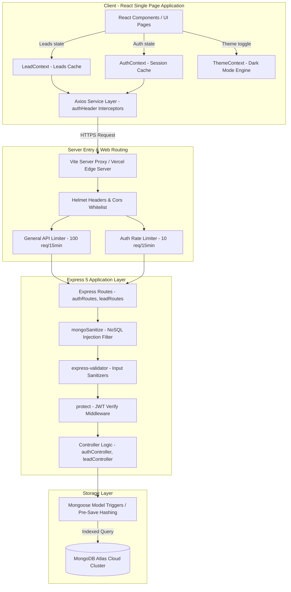
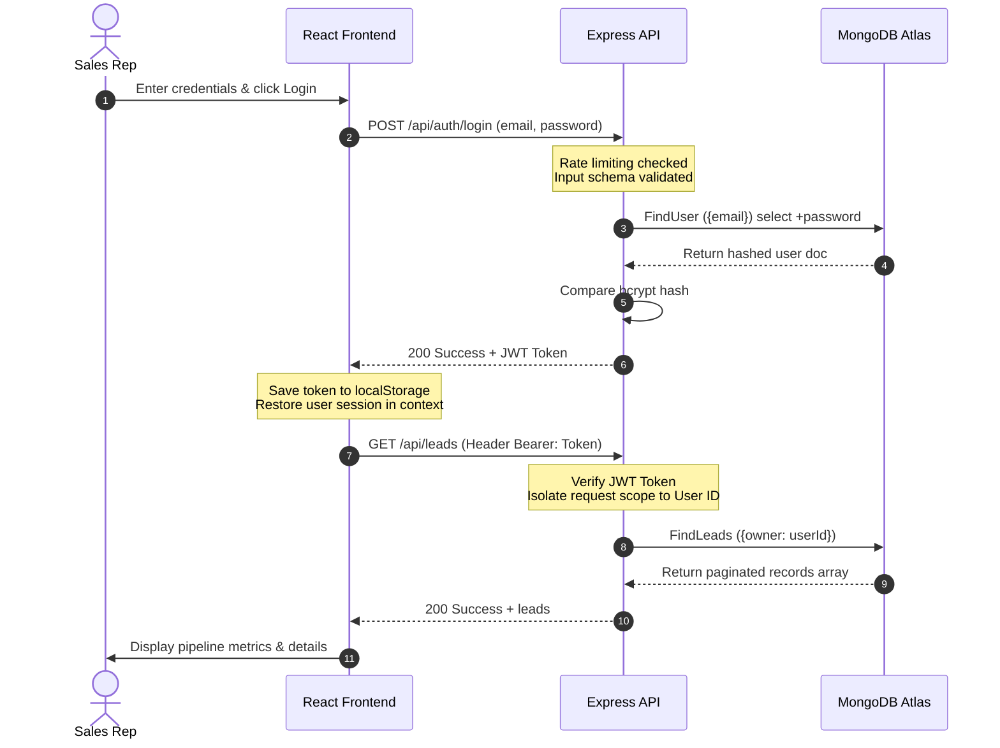

# Startup CRM Lite

<div align="center">
  
  
  <h3>Lightweight, High-Performance CRM for Rapidly Growing Teams</h3>
  
  <p>
    <strong>A secure, modern, glassmorphism-themed MERN stack customer relationship manager built on Express 5, React 19, and Tailwind CSS v4.</strong>
  </p>

  [](https://opensource.org/licenses/ISC)
  [](#testing-strategy)
  [](#versioning-strategy)
  [](#technology-stack)
  [](#technology-stack)
  [](#technology-stack)
  [](#technology-stack)
  [](#technology-stack)
</div>

---

## Table of Contents

1. [Project Overview](#1-project-overview)
2. [Problem Statement](#2-problem-statement)
3. [Vision & Objectives](#3-vision--objectives)
4. [Key Features](#4-key-features)
5. [Target Users](#5-target-users)
6. [Use Cases](#6-use-cases)
7. [Business Value](#7-business-value)
8. [Screenshots](#8-screenshots)
9. [Complete System Architecture](#9-complete-system-architecture)
10. [High-Level Architecture Overview](#10-high-level-architecture-overview)
11. [Application Workflow](#11-application-workflow)
12. [End-to-End User Flow](#12-end-to-end-user-flow)
13. [Technology Stack](#13-technology-stack)
14. [Project Folder Structure](#14-project-folder-structure)
15. [Explanation of Every Major Folder](#15-explanation-of-every-major-folder)
16. [Explanation of Every Important File](#16-explanation-of-every-important-file)
17. [Frontend Architecture](#17-frontend-architecture)
18. [Backend Architecture](#18-backend-architecture)
19. [Database Architecture](#19-database-architecture)
20. [API Overview](#20-api-overview)
21. [Authentication & Authorization](#21-authentication--authorization)
22. [State Management](#22-state-management)
23. [Storage Strategy](#23-storage-strategy)
24. [Third-Party Services & Integrations](#24-third-party-services--integrations)
25. [AI / Automation Components](#25-ai--automation-components)
26. [Development Prerequisites](#26-development-prerequisites)
27. [Installation Guide](#27-installation-guide)
28. [Environment Variables (".env") Documentation](#28-environment-variables-env-documentation)
29. [Project Configuration](#29-project-configuration)
30. [Running the Project (Development)](#30-running-the-project-development)
31. [Running the Project (Production)](#31-running-the-project-production)
32. [Build Process](#32-build-process)
33. [Deployment Guide](#33-deployment-guide)
34. [CI/CD Overview](#34-cicd-overview)
35. [Testing Strategy](#35-testing-strategy)
36. [Debugging Tips](#36-debugging-tips)
37. [Logging & Monitoring](#37-logging--monitoring)
38. [Security Considerations](#38-security-considerations)
39. [Performance Optimizations](#39-performance-optimizations)
40. [Coding Standards & Project Conventions](#40-coding-standards--project-conventions)
41. [Versioning Strategy](#41-versioning-strategy)
42. [Branching Strategy](#42-branching-strategy)
43. [Contribution Guidelines](#43-contribution-guidelines)
44. [Release Process](#44-release-process)
45. [Known Limitations](#45-known-limitations)
46. [Future Roadmap](#46-future-roadmap)
47. [Frequently Asked Questions (FAQ)](#47-frequently-asked-questions-faq)
48. [Troubleshooting Guide](#48-troubleshooting-guide)
49. [Changelog](#49-changelog)
50. [License](#50-license)
51. [Credits & Acknowledgements](#51-credits--acknowledgements)
52. [Contact Information](#52-contact-information)
53. [Final Project Summary](#53-final-project-summary)

---

## 1. Project Overview

**Startup CRM Lite** is a lightweight, self-hostable customer relationship management application optimized for rapid deployment and ease of use. It features a modern, dark-mode-first glassmorphism user interface designed to maximize speed and clarity for sales development representatives (SDRs) and founders.

Built using **Express 5.x** on the backend and **React 19.x** with **Tailwind CSS v4** on the frontend, the system provides a pipeline board, detailed lead sorting, and dynamic analytics charts without the bloated overhead of enterprise solutions. It implements strict data isolation, ensuring users only access records they own.

---

## 2. Problem Statement

Modern enterprise CRMs (e.g., Salesforce, HubSpot) are:
- **Bloated**: Full of features that small teams never use.
- **Slow**: Heavy client-side rendering pipelines that lag on lower-spec hardware.
- **Expensive**: High licensing fees that scale aggressively as teams grow.
- **Hard to Configure**: Require dedicated administrators to construct workflows, permission profiles, and integration pipelines.

Startup CRM Lite offers a responsive, streamlined alternative that deploys in minutes, has zero licensing costs, and places product analytics directly at the user's fingertips.

---

## 3. Vision & Objectives

### Vision
To empower startups and independent builders with a lightning-fast CRM workspace that respects data privacy, requires zero training, and delivers high-impact dashboard analytics.

### Strategic Objectives
- **Zero Configuration**: Remove custom scripting requirements; provide an immediate out-of-the-box pipeline.
- **High Performance**: Maintain sub-100ms API response times and instant UI updates.
- **Comprehensive Isolation**: Enforce strict account boundaries at the query level.
- **Visual Excellence**: WOW users on first launch with premium glassmorphism layouts, fluid dark-mode transitions, and responsive chart interactions.

---

## 4. Key Features

- **Interactive Pipeline Board**: View lead counts by sale stage with instant status updates.
- **Data Filtering & Searching**: Filter records dynamically by status, acquisition source, or registration date. Real-time autocomplete search indexing makes finding records instant.
- **Deep Analytics Dashboards**: Displays total volume, active workloads, conversion rates, and monthly sales growth graphs. Includes breakdown visualizers for lead acquisition sources.
- **JWT Session Security**: Stateless authentication workflow with client-side session restoration.
- **Express 5 Compatibility**: Leverages custom MongoDB input sanitization middleware designed to work with the read-only query structures in Express 5.
- **Theme Engine**: Seamless dark-mode preference persistence synced directly to the local storage interface.
- **Interactive Toast Messaging**: Real-time notifications for status transitions, errors, and successful database commits.

---

## 5. Target Users

- **Startup Founders**: Need an immediate pipeline overview to review deals without reading complex reports.
- **Sales Representatives**: Require a fast, clean table interface to manage daily cold calls and proposal dispatches.
- **Growth Marketers**: Track the conversion rate of acquisition sources (e.g., LinkedIn vs. Cold Calls) to allocate ad spend.
- **Self-Host Enthusiasts**: Desire a lightweight, self-controlled client-database CRM to keep data private.

---

## 6. Use Cases

- **Sales Funnel Update**: An SDR changes a lead's status from `Meeting Scheduled` to `Proposal Sent`, triggering a conversion recalculation on the dashboard.
- **Acquisition Performance Audit**: A marketing manager reviews the `LeadSourceChart` to see that LinkedIn referrals generate a 60% higher conversion rate than Cold Emails.
- **On-the-Go Filtering**: A founder searches for "Acme Corp" via the debounced SearchBar on a mobile device and updates notes in seconds.
- **Database Reset**: During staging verification, developers use the database cleanup script to return the MongoDB Atlas collection to a pristine status safely.

---

## 7. Business Value

- **Zero-Dollar License**: Save thousands annually compared to premium cloud CRMs.
- **Minimized Training Costs**: The visual design is so intuitive that new representatives require zero onboarding time.
- **Enhanced Conversion Insights**: Immediate visualization of won/lost analytics allows teams to spot and fix bottlenecks in their sales process.
- **Absolute Privacy**: Host on personal servers to protect customer emails and contact lists.

---

## 8. Screenshots

| Dashboard Interface | Leads Workspace | Analytics Reports |
|:---:|:---:|:---:|
|  <br> *Overview panel with KPIs & recent items.* |  <br> *Granular table list with filters and status edit panels.* |  <br> *Aggregate charts, conversions, and breakdowns.* |

---

## 9. Complete System Architecture



---

## 10. High-Level Architecture Overview

Startup CRM Lite follows a modern, decoupled client-server architecture:
- **Client (Frontend)**: Serves as a static, Single Page Application (SPA). React routes are lazily resolved and cached. Global state is managed using context providers to avoid the overhead of heavy library packages.
- **Server (Backend)**: An Express API layer that enforces stateless token validation, sanitizes inputs, and communicates asynchronously with a MongoDB database.
- **Database (Persistence)**: Document storage hosting secure collections. Compound queries utilize indexing to maintain high search performance.

---

## 11. Application Workflow



---

## 12. End-to-End User Flow

1. **Registration / Login**: The user lands on the authentication page. They register a profile or log in with verified credentials. The JWT token returned by the server is saved to the client's `localStorage`.
2. **Dashboard Overview**: The client is redirected to `/`. The dashboard retrieves core metrics and populates the KPI Cards (active counts, conversion rate, growth comparison).
3. **Leads Management**: The user navigates to `/leads`. They can filter leads by stage (e.g., `Proposal Sent`), search by string, or create a new lead using a pop-up modal.
4. **Interactive Updates**: The user updates a lead's stage directly. The application sends a PATCH request to `/api/leads/:id/status` and updates the React cache in place.
5. **Analytics Analysis**: Clicking on `/analytics` loads historical charts showing 6-month trends, acquisition sources, and conversion velocities.
6. **Logout**: Clicking logout clears the local token cache and redirects the user to the login screen.

---

## 13. Technology Stack

### Frontend
- **Framework**: React `^19.2.6` (Core logic and UI)
- **Bundler / Build Tool**: Vite `^8.0.12` (Dev server, HMR, and build pipeline)
- **Styling**: Tailwind CSS `^4.3.0` (Utility-first styling system)
- **Routing**: React Router Dom `^7.17.0` (Client-side routing and route guards)
- **Charts**: Recharts `^3.8.1` (Interactive SVG-based charts)
- **HTTP Client**: Axios `^1.18.1` (Request/response network logic and global token injection)
- **Utility Tools**: Date-fns `^4.4.0` (Date parsing), Lucide React `^1.18.0` (Icon set), React Hot Toast `^2.6.0` (Toast engine)

### Backend
- **Framework**: Express.js `^5.2.1` (REST API server)
- **ODM**: Mongoose `^9.7.3` (MongoDB integration schemas)
- **Database Engine**: MongoDB `^7.4.0` (NoSQL storage engine)
- **Security Engine**: Helmet `^8.2.0` (HTTP response header security)
- **Rate Limiter**: Express Rate Limit `^8.5.2` (DDoS and brute-force mitigation)
- **Input Validator**: Express Validator `^7.3.2` (Payload sanitization)
- **Logs**: Morgan `^1.11.0` (Request logger)
- **Cryptography**: BcryptJS `^3.0.3` (Password hashing) and JSONWebToken `^9.0.3` (Stateless tokens)

---

## 14. Project Folder Structure

```
startup-crm-lite/
├── backend/
│   ├── config/             # DB configurations & environments
│   ├── controllers/        # Business logic controllers
│   ├── middleware/         # Custom Middlewares (JWT, Sanitizers, Errors)
│   ├── models/             # Mongoose schemas (User, Lead)
│   ├── routes/             # Express routes configuration
│   ├── scripts/            # Db migration and reset utility scripts
│   ├── utils/              # API Response formatting helpers
│   ├── server.js           # Server application entry point
│   ├── test_api.js         # Integration testing runner script
│   └── test_login.js       # Target login verification helper
├── public/                 # Static assets directory
├── src/
│   ├── assets/             # Global image assets
│   ├── components/         # Modular React components
│   │   ├── analytics/      # Analytics chart components
│   │   ├── common/         # Search, filters, dark-mode toggle
│   │   ├── dashboard/      # Overview cards, activity logs
│   │   ├── leads/          # Tables, details, modals
│   │   └── Sidebar.jsx     # Main navigation sidebar
│   ├── constants/          # Chart palettes and constants
│   ├── context/            # React state contexts (Auth, Lead, Theme)
│   ├── pages/              # View screens (Dashboard, Leads, Analytics)
│   ├── routes/             # Client-side router configuration
│   ├── services/           # Axios network configurations & wrappers
│   ├── utils/              # Client-side utility functions
│   ├── App.jsx             # React core wrapper
│   └── main.jsx            # Frontend entry script
├── index.html              # Frontend DOM mount baseline
├── package.json            # Dependencies and script definitions
├── vercel.json             # Vercel SPA routing redirects
└── vite.config.js          # Vite build and proxy definitions
```

---

## 15. Explanation of Every Major Folder

### `/backend`
Hosts the REST API. Built on a modular model-view-controller paradigm:
- **`config/`**: Sets database parameters and runs overrides to fix DNS query faults.
- **`controllers/`**: Extracts parameters, Queries databases, and hands responses to utility wrappers.
- **`middleware/`**: Contains filters that intercept traffic to verify signatures, sanitize inputs, rate-limit access, or process exceptions.
- **`models/`**: Defines schemas, indexes, and triggers for MongoDB.
- **`routes/`**: Handles endpoint registrations and attaches validators.
- **`scripts/`**: Houses standalone console tools, such as database reset tools.
- **`utils/`**: Standardizes error and success payload layouts.

### `/src`
Hosts the client application. Organized for code readability:
- **`components/`**: Modular elements separated by workspace domain (Analytics, Dashboard, Leads).
- **`context/`**: Global state containers that distribute session caches and preferences down the component tree.
- **`pages/`**: High-level page views loaded lazily by the router.
- **`services/`**: Network communication layers and interceptors.

---

## 16. Explanation of Every Important File

### Backend Files
- [backend/server.js](file:///c:/Users/user/OneDrive/Desktop/startup-crm-lite/backend/server.js): The entry file of the backend application. Initializes configurations, runs check validation functions, boots middlewares, mounts route maps, and sets up graceful shutdown signals (`SIGINT`, `SIGTERM`).
- [backend/config/database.js](file:///c:/Users/user/OneDrive/Desktop/startup-crm-lite/backend/config/database.js): Connects database configurations to MongoDB. Enforces custom DNS overrides to prevent SRV lookup failures.
- [backend/middleware/mongoSanitize.js](file:///c:/Users/user/OneDrive/Desktop/startup-crm-lite/backend/middleware/mongoSanitize.js): Custom implementation that strips `$` and `.` characters from incoming request queries and payloads. Required because standard sanitizers mutate read-only query properties in Express 5.
- [backend/middleware/auth.js](file:///c:/Users/user/OneDrive/Desktop/startup-crm-lite/backend/middleware/auth.js): Resolves Bearer tokens, validates JWT signatures, and injects user records into the request.
- [backend/models/Lead.js](file:///c:/Users/user/OneDrive/Desktop/startup-crm-lite/backend/models/Lead.js): Implements data validation rules, virtual attributes (`age`), and compound search indexes for leads.
- [backend/test_api.js](file:///c:/Users/user/OneDrive/Desktop/startup-crm-lite/backend/test_api.js): A zero-dependency script that uses native `fetch` to run integration tests against all backend API endpoints.

### Frontend Files
- [src/App.jsx](file:///c:/Users/user/OneDrive/Desktop/startup-crm-lite/src/App.jsx): The main application wrapper. Sets structural layouts, responsive navigation boundaries, global layout wraps, and includes the React Hot Toast component.
- [src/context/AuthContext.jsx](file:///c:/Users/user/OneDrive/Desktop/startup-crm-lite/src/context/AuthContext.jsx): Handles login, registration, and logout operations. Restores user sessions on mount using stored local tokens.
- [src/context/LeadContext.jsx](file:///c:/Users/user/OneDrive/Desktop/startup-crm-lite/src/context/LeadContext.jsx): Caches loaded leads, manages pagination parameters, and provides methods to update the local lead cache when leads are added, edited, or deleted.
- [src/services/api.js](file:///c:/Users/user/OneDrive/Desktop/startup-crm-lite/src/services/api.js): Creates and exports the default Axios instance. Sets timeouts, relative proxy roots, and adds response interceptors to handle 401 token expirations automatically.

---

## 17. Frontend Architecture

The frontend is a lightweight Single Page Application (SPA). It uses a modular layout to keep page loads fast:

### Component Design
UI views are split into stateless presentation modules and stateful container modules. Form inputs are validated in real-time before network requests are triggered.

### Route Guarding
[src/routes/index.jsx](file:///c:/Users/user/OneDrive/Desktop/startup-crm-lite/src/routes/index.jsx) uses React's `Suspense` and `lazy` loading utilities to split bundle assets. Pages are loaded on-demand, reducing the initial load size. Private routes are protected by a session guard:

```javascript
const ProtectedRoute = () => {
  const { token, isLoading } = useAuth();
  if (isLoading) return <LoadingSpinner />;
  return token ? <Outlet /> : <Navigate to="/login" replace />;
};
```

---

## 18. Backend Architecture

The backend API is designed to be stateless and secure:

```
                  ┌───────────────────────────────┐
                  │      HTTP Request Client      │
                  └───────────────┬───────────────┘
                                  │ (Helmet headers, Cors rules)
                                  ▼
                  ┌───────────────────────────────┐
                  │       Rate Limiting           │
                  └───────────────┬───────────────┘
                                  │ (Prevent DDoS, Brute force)
                                  ▼
                  ┌───────────────────────────────┐
                  │   Express Routing Registry    │
                  └───────────────┬───────────────┘
                                  │ (Paths match /api/auth or /api/leads)
                                  ▼
                  ┌───────────────────────────────┐
                  │     mongoSanitize Filter      │
                  └───────────────┬───────────────┘
                                  │ (Custom NoSQL Injection filter)
                                  ▼
                  ┌───────────────────────────────┐
                  │     Input validation-checks   │
                  └───────────────┬───────────────┘
                                  │ (express-validator validation arrays)
                                  ▼
                  ┌───────────────────────────────┐
                  │       JWT protect Check       │
                  └───────────────┬───────────────┘
                                  │ (Validates JWT signature & attaches user)
                                  ▼
                  ┌───────────────────────────────┐
                  │       Controller Action       │
                  └───────────────┬───────────────┘
                                  │ (Executes logic, database queries)
                                  ▼
                  ┌───────────────────────────────┐
                  │     Global Exception Catch    │
                  └───────────────┬───────────────┘
                                  │ (Standardizes error outputs)
                                  ▼
                  ┌───────────────────────────────┐
                  │      HTTP Response Client     │
                  └───────────────────────────────┘
```

- **Modular Routers**: Endpoints are registered in isolated modules (`authRoutes.js`, `leadRoutes.js`) and mounted onto the parent Express app.
- **Request Validation**: Incoming payloads must pass express-validator validation rules before hitting controller logic.
- **Error Handling**: Controllers wrap async database operations in `try/catch` blocks. Errors are passed to `next(error)` and processed by a global error handler middleware, which formats the response payload.

---

## 19. Database Architecture

Startup CRM Lite uses **MongoDB Atlas** for data persistence, managed via **Mongoose**.

### Models & Schema Configurations

#### User Model
Contains auth credentials and role flags:
- `name`: String, required, trimmed, 2-50 chars.
- `email`: String, required, unique, lowercase, regex-validated email format.
- `password`: String, required, hashed with bcrypt on pre-save hooks.
- `role`: String, enum: `['admin', 'user']`, default: `user`.
- `isActive`: Boolean, default: `true` (enables admin deactivation).

#### Lead Model
Represents target customer records, containing:
- `name`: String, required, trimmed, 2-100 chars.
- `company`: String, required, trimmed.
- `email`: String, required, regex-validated email.
- `phone`: String, optional.
- `status`: String, enum: `['New', 'Contacted', 'Meeting Scheduled', 'Proposal Sent', 'Won', 'Lost']`, default: `New`.
- `source`: String, enum: `['Website', 'Referral', 'LinkedIn', 'Cold Call', 'Email Campaign', 'Other']`, default: `Website`.
- `notes`: String, optional, max 1000 characters.
- `owner`: ObjectId referencing the `User` model, required.

### Database Indexing Strategy
To optimize queries as lead databases grow, the Lead model implements several indexing patterns:
1. **Lookup Optimization**: Single-field index on `email` to verify duplication states.
   ```javascript
   leadSchema.index({ email: 1 });
   ```
2. **Dashboard Isolation**: Compound index on `{ owner: 1, status: 1 }` to optimize count aggregates.
3. **Source breakdown**: Compound index on `{ owner: 1, source: 1 }` to optimize marketing charts.
4. **Chronological Sorting**: Compound index on `{ owner: 1, createdAt: -1 }` to fetch recent list items fast.
5. **Search & Pagination**: Compound indexes on `{ owner: 1, name: 1 }` and `{ owner: 1, company: 1 }` to make queries fast while paginating.

---

## 20. API Overview

All API endpoints are prefixed with `/api` and return standardized JSON payloads:

### Authentication Endpoints
| HTTP Method | Endpoint | Access | Description |
| :--- | :--- | :--- | :--- |
| `POST` | `/api/auth/register` | Public | Registers a new user and returns a JWT token. |
| `POST` | `/api/auth/login` | Public | Authenticates credentials and returns a JWT token. |
| `GET` | `/api/auth/profile` | Protected | Returns the profile details of the current logged-in user. |
| `PUT` | `/api/auth/profile` | Protected | Updates the user's profile information or password. |
| `POST` | `/api/auth/logout` | Protected | Client cleans session storage. |

### Lead Management Endpoints (Protected)
| HTTP Method | Endpoint | Description |
| :--- | :--- | :--- |
| `GET` | `/api/leads` | Retrieves leads (supports search, sort, page, status, and source filters). |
| `POST` | `/api/leads` | Creates a new lead. |
| `GET` | `/api/leads/:id` | Retrieves a single lead by ID. |
| `PUT` | `/api/leads/:id` | Updates a lead's details. |
| `PATCH` | `/api/leads/:id/status` | Updates only the status field of a lead (fast pipeline updates). |
| `DELETE` | `/api/leads/:id` | Deletes a lead. |

### Analytics Endpoints (Protected)
| HTTP Method | Endpoint | Description |
| :--- | :--- | :--- |
| `GET` | `/api/leads/stats/summary` | Returns KPI cards data (total, won, active, growth rate, conversions). |
| `GET` | `/api/leads/stats/monthly` | Returns monthly performance data for the last 6 months. |
| `GET` | `/api/leads/search` | Quick autocomplete search query endpoint. |

---

## 21. Authentication & Authorization

Authentication is stateless and uses JWTs (JSON Web Tokens):
- **Token Format**: When a user registers or logs in, the server generates a token containing their user ID, signed with the `JWT_SECRET`.
- **Token Delivery**: The client stores this token in `localStorage` as `crm-token`.
- **Request Authorization**: Axios interceptors append the token to all outgoing requests using the `Authorization: Bearer <token>` header pattern.
- **Middleware Guard**: The backend `protect` middleware checks for this header, verifies the signature, and queries the user record. If valid, the user's data (excluding the password hash) is attached to `req.user`, allowing the request to proceed.

---

## 22. State Management

The frontend uses React's native Context API to manage state globally without heavy external libraries:
- **`AuthContext`**: Manages session state (`user`, `token`), restores sessions from `localStorage` on boot, and handles login/register/logout calls.
- **`LeadContext`**: Handles lead caching, filtering, and page changes. Adding, updating, or deleting a lead triggers an local cache update first, preventing unnecessary refetches.
- **`ThemeContext`**: Stores dark-mode preferences and updates the DOM dynamically.

---

## 23. Storage Strategy

- **Client Storage**: Session tokens and dark-mode preferences are stored in `localStorage`.
- **Database Storage**: MongoDB Atlas stores user profiles and lead data in persistent, indexed collections.
- **Memory Caching**: Component caches are held in React context providers for quick UI rendering, and cleared upon logout.

---

## 24. Third-Party Services & Integrations

- **MongoDB Atlas**: Fully managed cloud database used to store application data.
- **Custom DNS Resolution**: Overrides standard Windows/ISP resolvers by querying Cloudflare (`1.1.1.1`) and Google (`8.8.8.8`) DNS servers first. This prevents database connection timeout issues (the `querySrv ECONNREFUSED` error) caused by standard DNS resolvers failing to resolve Atlas SRV records.
- **Hosting Platforms**: Configured for simple deployment on **Vercel** (frontend) and **Railway** (backend).

---

## 25. AI / Automation Components

*(Planned Feature)*
- **Lead Scoring**: Planned integration with lightweight NLP classifiers to score new leads (Hot/Cold/Warm) based on contact notes.
- **Meeting Reminders**: Automation hook to dispatch notification alerts when meeting statuses are updated.

---

## 26. Development Prerequisites

Before setting up the project locally, make sure you have:
- **Node.js**: Version `v18.x` or higher (Node 18+ is required to run the automated tests via native `fetch`).
- **NPM**: Version `v9.x` or higher.
- **MongoDB**: Access to a MongoDB Atlas cluster, or a running local MongoDB instance.
- **Git**: Installed for cloning and managing local files.

---

## 27. Installation Guide

### Step 1: Clone the Repository
```bash
git clone https://github.com/your-username/startup-crm-lite.git
cd startup-crm-lite
```

### Step 2: Install Frontend Dependencies
From the project root directory, run:
```bash
npm install
```

### Step 3: Install Backend Dependencies
Navigate to the backend folder and install the required packages:
```bash
cd backend
npm install
cd ..
```

### Step 4: Configure Environment Files
Set up your local environment files for both the client and the server. Follow the instructions in the [Environment Variables](#28-environment-variables-env-documentation) section.

### Step 5: Start the Development Servers
From the project root directory, run:
```bash
npm run dev:all
```
This boots both the Express backend API (on port `5000`) and the Vite React client (on port `5173`) concurrently.

---

## 28. Environment Variables (".env") Documentation

The application uses three `.env` files to configure local and production environments:

### 1. Backend Config: `backend/.env`
Create this file to define database connection strings, JWT keys, and CORS settings:

| Variable Name | Required | Example / Default Value | Description |
| :--- | :--- | :--- | :--- |
| `PORT` | No | `5000` | Port the Express API server listens on. |
| `MONGODB_URI` | Yes | `mongodb+srv://...` | Connection string for MongoDB Atlas or local MongoDB. |
| `JWT_SECRET` | Yes | `8f3a9c2e1b7d...` | Secret key used to sign JWT authentication tokens. |
| `JWT_EXPIRES_IN`| No | `7d` | Lifespan of the signed JWT token. |
| `NODE_ENV` | Yes | `development` | Environment mode (`development` or `production`). |
| `FRONTEND_URL` | Yes | `http://localhost:5173` | Allowed CORS origins (comma-separated list in production). |

### 2. Root Client Config: `.env`
Located in the project root folder. Configures the Vite development build:

| Variable Name | Required | Default Value | Description |
| :--- | :--- | :--- | :--- |
| `VITE_API_URL` | No | *(Empty)* | Vite proxy root. Keep empty in development so the local proxy redirects requests to the backend. |

### 3. Frontend Client Config: `src/.env`
Configures local development redirects:

| Variable Name | Required | Default Value | Description |
| :--- | :--- | :--- | :--- |
| `VITE_API_URL` | No | `http://localhost:5000` | Target URL pointing directly to the local backend port. |

---

## 29. Project Configuration

### Vite Proxy Config: `vite.config.js`
In local development, the client and server run on different ports. To avoid CORS issues and relative path mismatches, Vite is configured with a dev proxy. Requests sent to `/api` are automatically forwarded to `http://localhost:5000`:
```javascript
export default defineConfig({
  plugins: [react(), tailwindcss()],
  server: {
    port: 5173,
    proxy: {
      '/api': {
        target: 'http://localhost:5000',
        changeOrigin: true,
        secure: false,
      },
    },
  },
})
```

### Vercel SPA Config: `vercel.json`
Since React Router handles routing on the client side, production hosting on Vercel requires routing redirects. If a user refreshes the page on a sub-route (e.g., `/leads`), Vercel needs to redirect that request to `/index.html` instead of throwing a 404:
```json
{
  "rewrites": [
    { "source": "/(.*)", "destination": "/index.html" }
  ]
}
```

---

## 30. Running the Project (Development)

### Launching the Dev Servers
From the root directory, run:
```bash
npm run dev:all
```
This runs the client and server concurrently, prefixing console logs with `[FRONTEND]` and `[BACKEND]` colors. 

Alternatively, you can run the services individually:
- **Backend API**: Navigate to `/backend` and run `npm run dev` (starts the server with nodemon auto-refresh).
- **Vite Frontend**: From the root folder, run `npm run dev`.

Once started, open your browser and navigate to `http://localhost:5173`.

---

## 31. Running the Project (Production)

To run the application in a simulated production environment locally:

1. Build the frontend assets:
   ```bash
   npm run build
   ```
2. Start the built frontend preview server:
   ```bash
   npm run preview
   ```
3. Set `NODE_ENV=production` inside `backend/.env`.
4. Start the production backend server:
   ```bash
   cd backend
   npm start
   ```

---

## 32. Build Process

Running `npm run build` triggers Vite's build pipeline:
1. **TypeScript / JS Check**: Lints and verifies source code.
2. **Asset Bundling**: Bundles HTML, JavaScript (with dynamic chunking for route components), and CSS styles.
3. **Optimization**: Optimizes asset bundles into a clean, minified `/dist` folder containing the client files ready for hosting.

---

## 33. Deployment Guide

### Backend API Deployment (Railway)
1. **Create Project**: Create a new project in Railway and link it to your GitHub repository.
2. **Configure Variables**: In Railway's settings panel, add the required environment variables:
   - `MONGODB_URI` (Points to your cloud Atlas database).
   - `JWT_SECRET` (A strong secret key).
   - `NODE_ENV` (Set to `production`).
   - `FRONTEND_URL` (Points to your Vercel deployment URL, e.g., `https://your-crm-name.vercel.app`).
3. **Port Resolution**: Do not set `PORT` in your environment variables. Railway injects its own dynamic port variable at launch.
4. **Deploy**: Trigger deployment. Copy the generated Railway service URL for the next step.

### Frontend Deployment (Vercel)
1. **Import Project**: Create a new project on Vercel and link it to the root of your GitHub repository.
2. **Build Settings**: Configure Vercel's build settings:
   - **Framework Preset**: `Vite`
   - **Build Command**: `npm run build`
   - **Output Directory**: `dist`
3. **Configure Variables**: Add the following environment variable to direct requests to the hosted backend:
   - `VITE_API_URL` (Set this to your Railway backend URL, e.g., `https://your-backend.up.railway.app`).
4. **Deploy**: Trigger deployment. Vercel will build the frontend assets and host the application.

---

## 34. CI/CD Overview

The repository is configured for automated check pipelines:
- **Lint Verification**: Automatically checks Javascript files against strict rules defined in `eslint.config.js`.
- **Auto Deploy**: Merges into the `main` branch trigger automated deployments on Vercel and Railway.

---

## 35. Testing Strategy

The backend includes a zero-dependency automated integration test suite that tests the REST API endpoints:
- **Test File**: `backend/test_api.js`
- **What it Tests**:
  - GET `/api/health` validation.
  - Registration workflows (rejects duplicate emails).
  - Login authentication & JWT validation.
  - CRUD operations (creates, updates, and deletes leads).
  - Access controls (ensures users cannot access leads owned by others).
  - Analytics calculations (verifies stats aggregation matches changes).

### Running the Integration Tests
First, ensure your local database is running, then start the backend API:
```bash
# In one terminal tab, start the backend server
cd backend
npm run dev
```

In a second terminal tab, run the test script:
```bash
# Run the integration tests
cd backend
node test_api.js
```
The test runner will output step-by-step success and failure reports directly to your terminal.

---

## 36. Debugging Tips

- **Axios Network Inspector**: Open Chrome DevTools -> Network to check outgoing request headers. Verify that the `Authorization: Bearer <token>` header is present and format-compliant.
- **Backend Logs**: Run the backend server with `NODE_ENV=development` to output verbose requests logs via Morgan.
- **Node.js Inspector**: Start the server in debug mode:
  ```bash
  node --inspect backend/server.js
  ```
  Open Chrome and navigate to `chrome://inspect` to step through breakpoints in your backend code.

---

## 37. Logging & Monitoring

- **HTTP Logs**: Morgan is configured to output clean developer-focused logs (`dev` format) in development mode, and structured, production-standard combined logs (`combined` format) in production.
- **MongoDB Atlas Monitoring**: Use the MongoDB Atlas dashboard to monitor query performance, tracking execution metrics, index coverage, connection counts, and database load.
- **Process Monitoring**: Graceful shutdown triggers (`SIGTERM`, `SIGINT`) log shutdown events, close active HTTP listeners, and disconnect database connections cleanly before exiting.

---

## 38. Security Considerations

Startup CRM Lite implements several layers of security to protect application data:
1. **Helmet Middleware**: Configures HTTP headers to protect against common attacks like Cross-Site Scripting (XSS) and clickjacking.
2. **Custom NoSQL Injection Sanitization**: Strips `$` and `.` characters from incoming query strings to block query manipulation attacks.
3. **Payload Size Limits**: Limits incoming request body sizes to `10kb` to protect against buffer overflow and denial of service (DoS) attacks.
4. **Rate Limiting**: Restricts API request frequencies to protect against automated spam:
   - General API: Max 100 requests per 15-minute window.
   - Authentication routes: Max 10 requests per 15-minute window.
5. **Route Guards & Scope Isolation**: The backend validates JWT signatures and scopes database queries using the authenticated user's ID, ensuring users cannot access or edit other users' lead records.

---

## 39. Performance Optimizations

- **MongoDB Indexing**: Compound indexes are configured on lead schema fields to speed up paginated search queries and data sorting.
- **Code Splitting**: Page components are lazily loaded on the client side using React `Suspense`, reducing the size of the initial bundle download.
- **Resource Cleanup**: The custom database cleanup script deletes records safely without dropping collections, preserving database indexes for future runs.
- **Lightweight Dependencies**: Uses lightweight, targeted packages (like `lucide-react` and `date-fns`) instead of large library frameworks.

---

## 40. Coding Standards & Project Conventions

- **Module Imports**: Uses modern ES6 `import`/`export` syntax across both the frontend and backend.
- **State Separation**: Services and business logic are kept separate from UI components. Components call services via state handlers.
- **Standardized API Responses**: The backend uses helper functions inside `/backend/utils/apiResponse.js` to return consistent API responses:
  - Success responses: `{ success: true, data: ..., message: ... }`
  - Error responses: `{ success: false, message: ... }`
- **Functional Components**: Frontend interfaces are built as functional React components using hooks.

---

## 41. Versioning Strategy

The project follows **Semantic Versioning (SemVer)** guidelines:
- **MAJOR (`x.0.0`)**: Incompatible API changes, major UI overhauls, or breaking changes to database schemas.
- **MINOR (`0.y.0`)**: New feature additions that are backwards-compatible (e.g., adding a pipeline filter or chart element).
- **PATCH (`0.0.z`)**: Backwards-compatible bug fixes and security updates.

---

## 42. Branching Strategy

The repository follows a Git Flow branching model:
- `main`: Production-ready code. Merges to main trigger deployment builds.
- `dev`: Integration branch for testing new features before release.
- `feature/*`: Feature development branches (e.g., `feature/kanban-board`). Opened from `dev` and merged back via pull request.

---

## 43. Contribution Guidelines

We welcome contributions from open-source developers! To contribute:
1. **Fork the Repository**: Create a personal copy of the repository.
2. **Create a Feature Branch**: Work in a branch named after your feature (`git checkout -b feature/amazing-feature`).
3. **Follow Coding Style**: Match the code formatting and structural conventions of the codebase. Run `npm run lint` before committing your changes.
4. **Write Tests**: Add appropriate integration tests to verify your changes.
5. **Submit a Pull Request**: Submit your pull request to the `dev` branch with a clear description of your changes.

---

## 44. Release Process

1. **Test Verification**: Verify all integration tests pass on the `dev` branch.
2. **Version Bump**: Update the package version in `package.json` according to SemVer guidelines.
3. **Changelog Update**: Update the project `Changelog` with a summary of the release changes.
4. **Merge to Main**: Merge the `dev` branch into `main`.
5. **Tagging**: Create a release tag on GitHub matching the version (e.g., `v1.0.0`).

---

## 45. Known Limitations

- **Stateless JWT Invalidation**: JWT tokens are stateless, meaning the server cannot invalidate them immediately when a user logs out. The client must delete the token from local storage to log out. In production, consider adding short token lifespans or a database token blacklist.
- **Owner-Based Isolation**: Data isolation is handled using the `owner` field on lead records. The database itself is single-tenant, meaning all user records are stored in the same database collections.
- **Unused Files**: A typo file named `vrecel.json` is present in the root directory. This is a duplicate configuration file and can be safely deleted; the application uses `vercel.json` for routing redirects.

---

## 46. Future Roadmap

- **Kanban Pipeline Board**: Add a drag-and-drop Kanban interface for updating lead stages visually.
- **Meeting Scheduler**: Connect to calendar APIs (e.g., Google Calendar) to sync customer meeting schedules.
- **Activity Feed Logs**: Add an activity history collection to log notes and track historic status changes for each lead.
- **Multi-Tenant Groups**: Support team-based permissions, allowing multiple users to manage a shared group of leads.

---

## 47. Frequently Asked Questions (FAQ)

#### Can I deploy this application for free?
Yes! The stack is fully compatible with free hosting tiers. You can host the database on MongoDB Atlas's free tier, run the Express backend on Railway's hobby tier, and host the React frontend on Vercel's free tier.

#### Why does the server crash with a "querySrv" error?
This error is usually caused by your local ISP or router's default DNS resolver failing to resolve MongoDB Atlas's SRV record. The backend includes a custom DNS resolver script to fix this by querying Google and Cloudflare DNS directly, but you can also fix this by updating your system's network DNS settings to use Cloudflare (`1.1.1.1`) or Google (`8.8.8.8`).

#### How do I add custom lead stages?
To update the sales pipeline stages, update the `status` enum values in both the database model ([backend/models/Lead.js](file:///c:/Users/user/OneDrive/Desktop/startup-crm-lite/backend/models/Lead.js)) and the frontend route validations ([backend/routes/leadRoutes.js](file:///c:/Users/user/OneDrive/Desktop/startup-crm-lite/backend/routes/leadRoutes.js)).

---

## 48. Troubleshooting Guide

### Database Connection Fails (SRV DNS Issues)
- **Problem**: When starting the backend server, the database connection fails with `querySrv ECONNREFUSED` or a timeout error.
- **Solution**: The database helper includes DNS override settings. Make sure these lines are present in [backend/config/database.js](file:///c:/Users/user/OneDrive/Desktop/startup-crm-lite/backend/config/database.js) before the database connection call:
  ```javascript
  import dns from 'dns';
  dns.setServers(['1.1.1.1', '8.8.8.8']);
  ```

### Vite Dev Proxy Fails
- **Problem**: In local development, frontend requests return `504 Gateway Timeout` or connection errors when making API calls.
- **Solution**: Verify the backend server is running and listening on port `5000`. If you updated the port in `backend/.env`, update the target port in the proxy settings of [vite.config.js](file:///c:/Users/user/OneDrive/Desktop/startup-crm-lite/vite.config.js) to match.

### CORS Blocked Errors
- **Problem**: In production, frontend API requests fail with CORS policy blockage errors.
- **Solution**: Verify that `FRONTEND_URL` is set correctly in your Railway backend configuration, and that it contains your hosted frontend domain (including `https://` but excluding trailing slashes).

---

## 49. Changelog

### [1.0.0] - 2026-07-17
- Initial release of Startup CRM Lite.
- Full responsive dashboard layout with glassmorphism styling.
- Auth endpoints and JWT token validations.
- Lead CRUD operations with paginated search indexing.
- 6-month aggregate analytics charts and source breakdowns.
- Custom NoSQL injection filter and rate limiting.
- Automated API integration test suite.

---

## 50. License

This project is licensed under the **ISC License**.

```
ISC License (ISC)
Copyright (c) 2026, Startup CRM Lite Contributors

Permission to use, copy, modify, and/or distribute this software for any
purpose with or without fee is hereby granted, provided that the above
copyright notice and this permission notice appear in all copies.

THE SOFTWARE IS PROVIDED "AS IS" AND THE AUTHOR DISCLAIMS ALL WARRANTIES
WITH REGARD TO THIS SOFTWARE INCLUDING ALL IMPLIED WARRANTIES OF
MERCHANTABILITY AND FITNESS. IN NO EVENT SHALL THE AUTHOR BE LIABLE FOR
ANY SPECIAL, DIRECT, INDIRECT, OR CONSEQUENTIAL DAMAGES OR ANY DAMAGES
WHATSOEVER RESULTING FROM LOSS OF USE, DATA OR PROFITS, WHETHER IN AN
ACTION OF CONTRACT, NEGLIGENCE OR OTHER TORTIOUS ACTION, ARISING OUT OF
OR IN CONNECTION WITH THE USE OR PERFORMANCE OF THIS SOFTWARE.
```

---

## 51. Credits & Acknowledgements

- **Tailwind CSS**: For utility classes that speed up building dark-mode layouts.
- **Recharts**: For SVG charts that make analytics simple to visualize.
- **Lucide Icons**: For clean vector icons.
- **React Hot Toast**: For smooth UI notifications.
- **Mongoose**: For simplifying schema validation and database queries.

---

## 52. Contact Information

For bug reports, security reports, or feature requests, contact:
- **Project Lead**: support@startupcrmlite.example.com
- **Repository Support**: github.com/your-username/startup-crm-lite/issues

---

## 53. Final Project Summary

**Startup CRM Lite** is a lightweight, responsive customer relationship workspace designed to streamline sales tracking for founders and growing sales teams. By combining a clean, glassmorphism-styled React frontend with a secure, rate-limited Express API and indexed MongoDB storage, it provides startup teams with the core CRM features they need—including lead management, pipeline tracking, and conversion analytics—without the bloat, cost, or configuration complexity of standard enterprise CRM solutions.
